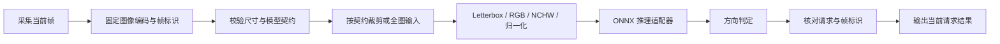

# 皮碗方向识别：从模型输出到可靠工程集成

这是一个经过抽象重写的技术分享项目，讨论视觉方向识别中的推理契约、图像一致性、后处理与当前帧结果校验。只提供通用方法和合成测试，不包含企业名称、真实图片、训练数据、模型权重、生产工程、设备配置、现场参数或业务统计。

示例不连接相机、PLC 或执行机构，也不提供已训练模型；运行结果不能直接用于生产控制。

## 技术路线



工程路线可以由独立 Python 推理服务与 C# 通信桥起步，再根据宿主接口、节拍与维护成本评估进程内 C++ 推理。两种方案都必须保持输入契约和当前帧身份一致。

## 快速运行

Python 3.10+，仅使用标准库：

```bash
python -m unittest discover -s tests -v
python examples/demo.py
```

`src/seal_vision/policy.py` 演示最高分方向判定与结果关联。所有分数、框和标识均为人为构造。门槛必须由调用者明确传入，不内置真实部署值。它没有加载或模拟训练好的识别模型。

## 值得分享的工程经验

1. **图像也是接口。** 灰度转换、JPEG 编码器、质量、缩放和重复编码都可能改变张量。对比系统时先对比相同字节，再对比裁剪结果与张量，最后比较输出。
2. **裁剪只能发生在契约指定的一层。** 全图包装模型可能已经包含 ROI。外部重复裁剪会让部署偏离训练输入。
3. **候选数不等于工件数。** 是否采用 NMS、如何解释多候选，取决于导出模型的输出语义，不能直接用输出行数否决工件。
4. **方向与放行规则分开。** 最高分方向、反面优先、多框否决是不同策略。额外规则会改变系统行为，必须逐条解释并单独验证。
5. **异常不能沿用上次结果。** 请求 ID 与帧 ID 必须匹配；超时、错帧、输出异常都产生本次不可放行结果。
6. **离线回放不是产线验收。** 合成单元测试、历史图片回放、真实相机连续运行和执行机构验证是不同证据。

详细设计见 [工程笔记](docs/engineering.md)，发布范围见 [隐私边界](docs/publication-scope.md)。

## 内容边界

本仓库是教学实现，不是原生产源码的脱敏副本，不复现任何组织的实际参数、精度、节拍或上线状态。未附带第三方 SDK、运行库和许可受限文件。仓库没有授予任何原项目或第三方资产的使用权。
